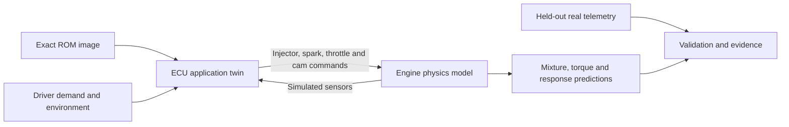

# ECU second brain — persistent understanding and adaptive models

Recorded 2026-09-22 from the operator discussion, and revised the same day
after a research review: Pi measurements, the diagnosis literature, a check
of River's source, and small-model fine-tuning practice. **Exploratory
roadmap; implementation is not started or authorized by this document.**
Checkboxes below are future work, not additions to the overnight queue.
Model choices are candidates pending measurement, not new operator-approved
defaults.

**Priority (operator, 2026-09-22).** The second brain's reasoning and
learning are deterministic and run on the Pi, live during the drive
([Reasoning and learning while driving](#reasoning-and-learning-while-driving)).
A language model is an optional interface on top of that, and hosting it
on the Pi is the last priority
([Optional language interface](#optional-language-interface-lower-priority)).

The design target is someone with only a Pi and an Android phone showing
the dashboard: no laptop, no Claude, no fast internet. Everything the brain
concludes must reach that user without a language model.

**Runtime and twin clarification (operator, 2026-10-04).** The second brain
runs on the Pi, including persistent memory and post-collection evaluation
and promotion. Its digital twin reproduces decoded ECU application logic
to predict outputs and verify observations. A laptop is optional for
development and firmware research; required operation works with only the
Pi and phone dashboard. The detailed implementation checklists are
[E00–E05](tasks/E00-second-brain-README.md).

## Purpose

Make CANary a supervisory brain that remembers the vehicle's history,
models what should happen, investigates discrepancies, and learns whether
a change actually helped. The ECU continues running the engine. CANary
builds understanding across drives and experiments:

**Observe → predict → investigate → propose → verify → remember.**

The useful output is an evidence-backed answer to four questions: what
happened, what might explain it, what remains unknown, and what measurement
would resolve that uncertainty. This extends telemetry and anomaly alerts
into a persistent diagnostic and performance-analysis workbench.

Existing foundations include RAM windows, commanded-versus-measured
analysis, behavior surfaces, physical cross-checks, tune provenance,
capture profiles, replay, MCP tools, and structured LLM-assist cards.
These capabilities do not yet constitute an autonomous investigation loop.

## Relationship to existing plans

- [LLM-assist and compute](llm-assist-and-compute-roadmap.md) owns the
  optional language interface: where a model is hosted, structured reports,
  retrieval, and the hosting seams. Its D1 keeps a language model off the
  collector's CPU during collection, and its D6 ranks the hosts. This
  proposal does not put a language model on the live inference path.
- [Online training](online-training-strategy.md) owns training-data
  disposition, accepted baseline differences, batch retraining, and
  promotion. This proposal does not replace those rules with indiscriminate
  per-sample updates to IF or the sequence autoencoder.
- [Behavior-model work](tasks/B00-behavior-models-README.md) owns serving
  contracts, eligibility, independent-drive validation, and qualified
  model publication. Build on that work rather than a parallel framework.
- [Structured cards](../llm-assist-card-schema.md) and
  [MCP](../mcp-server.md) provide existing output and tool contracts.
- [Supercharger build](supercharger-build.md) is the largest intervention
  this vehicle will have. It is weeks away and invalidates every learned
  reference, which makes it the first real use of the intervention and
  prediction records below.

## Build on the records that already exist

The project already keeps several of the records this plan needs, in
different shapes. Extend them; do not start a parallel store.

| Existing record | What it is today | What this plan adds |
|---|---|---|
| `data/<profile>/tune_revisions.yaml` | Calibration flashes with time and ROM hash | All interventions, including hardware: the supercharger plan notes that nothing records hardware |
| `data/<profile>/accepted_baselines.yaml` | Explicitly accepted baseline differences | A link to the investigation that justified each acceptance |
| `superseded_by` in `data/bindings.yaml` | Retracted bindings kept for old data | The same supersession for findings and hypotheses |
| `tests/fixtures/ground_truth/expectations.yaml` | Known answers the analysis chain must reproduce | The seed of the known-answer investigation cases |
| AGENTS.md retractions and `data/analyses/*.md` | Prose findings, including six retractions | Structured records with evidence references; the prose stays as narrative |
| `data/<profile>/noise_floor.yaml` | Measured noise with required `conditions` | The detectable-effect bound every prediction must state |

## Five capabilities

### 1. Shared understanding of engine state

Give analyses a common representation of operating conditions, ECU
commands, measured responses, and measurement quality. Include acquisition
timestamps, uncertainty where supported, channel availability, vehicle and
program identity, tune revision, and model applicability.

Read `vehicle_state` before interpreting live detector behavior. Distinguish
absent inputs, stale inputs, unknown context, inadequate coverage, failed
validation, and measured deviation. An unevaluable result cannot become
"normal" or a zero residual. RAM windows offer same-instant observations
of related internal quantities where supported by the vehicle profile.

### 2. Persistent evidence and intervention memory

Sessions are raw memory; investigations need structured records of:

- The observation, operating conditions, affected quantities, and quality.
- Supporting and contradicting evidence, with exact session/window and
  analysis-artifact references.
- Candidate explanations, unresolved questions, and proposed experiments.
- Interventions: calibration, component, fuel, or instrumentation changes.
- Predictions made before an intervention and results measured afterward.
- Superseded or retracted findings, retaining their history and reasons.

Conditions and provenance must be required schema fields, not optional
prose. Store this per vehicle; distinguish ECU program identity from tune
revision. A calibration change does not by itself invalidate RAM addresses.

**Evidence is minted by tools, never typed by a model.** Each analysis tool
that produces evidence writes an evidence record: id, tool and code
version, inputs, session and window, conditions, and the values it
computed. Investigations and cards cite evidence ids. A validator rejects
an id that no tool produced, and numbers shown with a claim are rendered
from the record. The first card contract did not do this: its free-text
`EvidenceReference` let a producer cite a session or a value no tool returned
and the card still validated. Since E01.2 (2026-10-04) cards cite evidence
ids minted on the vehicle's `src.evidence` memory ledger (first tool:
`tools/mint_comparison.py`), card prose cannot state numbers, and resolution
rejects invented, other-vehicle and misquoted ids; older cards remain as
explicitly unverified historical narrative. This is the "make it impossible,
not documented" rule applied where a language model is most likely to break
it.

**Every record carries two times.** One is when the thing happened (valid
time); the other is when CANary recorded or believed it (record time).
Superseded records also carry when they were superseded. "Did this precede
the last tune?" is a valid-time question. "What did we believe on
2026-09-10?" is a record-time question. Retractions need both
([bitemporal history](https://martinfowler.com/articles/bitemporal-history.html)).
Append-only JSONL, as the existing ledgers use, already supplies record
time; add `valid_from`/`valid_to` and `superseded_at`. DuckDB and SQLite
need no special support; overlap checks live in the application. The W3C
[PROV](https://www.w3.org/TR/prov-dm/) terms `wasDerivedFrom` and
`wasInvalidatedBy` are a reasonable naming guide for derivation and
retraction links.

Start with structured storage and exact filtering by vehicle, conditions,
revision, and time. At hundreds of records, field filters plus SQLite or
DuckDB full-text search are enough. Add embedding retrieval only after a
measured miss, because an embedding model also occupies Pi RAM. Retrieved
hypotheses remain hypotheses; generated text is not new evidence.

This should answer questions such as "Did this precede the last tune?" and
"Have we already tested this explanation, and what happened?"

### 3. Models that explain discrepancies

Connect models of air entering the engine, fuel commanded and delivered,
ignition behavior, cam response, and thermal behavior. Produce predictions
and qualified residuals, then use them as evidence for competing hypotheses.
Correlation alone cannot establish fault causation.

The established framework is consistency-based diagnosis. Write the
physical relations as equations. Derive residuals that are zero when those
equations hold. Then tabulate which fault moves which residual; that table
is the fault signature matrix. It states, before any drive, which faults
the current channels can detect and which they can tell apart
(isolability). Residual evidence then ranks hypotheses by computation, not
by generated prose.

The [Fault Diagnosis Toolbox](https://github.com/faultdiagnosistoolbox/pyfaultdiagnosistoolbox)
(Frisk, Krysander and Jung; Python package `faultdiagnosistoolbox`, MIT
licence, aarch64 wheels) implements the structural analysis, isolability
analysis, sensor placement, and residual generation. Its
[worked example](https://faultdiagnosistoolbox.github.io/usecase/) is a
turbocharged spark-ignition air path. Spike it before writing our own.

The desired explanation is: "Response differs from the command in this
region and from the validated baseline. These explanations fit the evidence;
this missing measurement would distinguish them."

Use `compare_channels` for raw signal comparisons, acquisition-time pairing,
and per-sample ratio checks where meaningful. Across interventions, compare
matched operating conditions, preserving independent-drive evidence. Do not
infer an improvement from aggregate means with different drive composition.

The [deterministic ECM twin](#first-ecm-twin-slice-target-equivalence-ratio)
below is a concrete model for this capability: reproduce one decoded ECM
calculation, then qualify its disagreement with the observed command.
The [firmware-informed behavior work](#using-firmware-findings-to-improve-behavior-models)
connects those calculations to learned relationships and investigation evidence.

### 4. An investigator that selects the next measurement

When evidence is ambiguous, propose a targeted capture recipe and a
predefined analysis. Explain which hypotheses its result would distinguish.
Account for acquisition timing, complete channel tuples, and bus capacity.
Preserve the relevant event window and respect an active operator capture.

Choose that measurement by computation. With a small, discrete set of
hypotheses, pick the test with the largest expected reduction in
uncertainty about which hypothesis holds, divided by its cost: drive time,
a key-on engine-off window, or an added gauge. This is the entropy rule of
[de Kleer & Williams (1987)](https://dekleer.org/Publications/Diagnosing%20Multiple%20Faults%20AIJ%20reprint.pdf)
and the cost-weighted troubleshooting of
[Heckerman, Breese & Rommelse (1995)](https://arxiv.org/abs/1302.3563).
Where no available channel separates two hypotheses, sensor-placement
analysis names the measurement that would.

The open WOT-lean question is the textbook case
([2026-09-21](../../data/analyses/2026-09-21-drive-tuning-2.md)). WOT reads
a flat ~3 % lean while part throttle is pulled rich. A MAF transfer error
and fuel-delivery sag leave the same signature on the current channels,
because the ECM reports no fuel pressure. Sensor-placement analysis would
name fuel pressure, which is the conclusion reached by hand
(supercharger-build NA2).

If a physical action is required, describe that action and its purpose.
An eventual automatic capture selector can use deterministic policies;
live operation must not depend on an LLM response.

No heavy session analysis runs on the Pi while it collects. The investigator
runs on the Pi as streaming updates during the drive (next section), and
bounded session analysis runs there after collection stops. A laptop can
accelerate development and research. Required investigation, evaluation and
memory workflows complete on the Pi without one. The optional language
interface runs wherever a host exists.

### 5. A learning loop around repairs and calibration

Before an intervention, record the expected direction, affected operating
region, and magnitude when the evidence supports one. Make that ordering a
schema rule, not a habit. A prediction whose record time is not earlier
than the intervention is stored as post-hoc and cannot count as confirmed.
Each magnitude sits beside the noise floor measured under the same
conditions; `noise_floor.yaml` already requires `conditions`. A null result
then says which kind it is: no effect, or an effect too small to see.

Afterward, evaluate under matched conditions. Bin rpm × load × IAT × baro
and compare within bins
([coarsened exact matching](https://gking.harvard.edu/cem)), never across
drives with different composition. Retain failed predictions. Failure can
identify a weak model or hypothesis rather than a failed repair.

A before/after comparison across a flash date is confounded by season,
altitude, and fuel batch. Where a calibration can be flashed back, an
A→B→A sequence is the design that separates the tune from those; plan it
with the `designed-experiments` skill. Each flash in such a sequence is a
separate non-volatile write under the rule below.

Future calibration proposals could include affected cells, supporting
evidence, expected effects, and unresolved uncertainty. Every ECU
non-volatile write still requires explicit operator permission for that
specific operation and a fresh `vehicle_state` verdict of `ignition_only`.
Refuse `engine_running` and unclassifiable states. This proposal authorizes
no ECU writes. Reads and ordinary volatile diagnostics retain the existing
project policy.

## Reasoning and learning while driving

"Reason and self-improve while driving" is done by deterministic streaming
methods on the Pi, not by a language model. Small numerical updates are
expected to be cheap; their individual and combined costs must pass the
Pi's measured collection/tick budget before enablement. They work at
different timescales:

| Loop | When it runs | Where | What it decides or learns |
|---|---|---|---|
| Residuals and change detection | Every tick | Pi, live | Whether behavior departs from the reference, and when it started |
| Parameter tracking | Every qualifying sample | Pi, live | Slowly varying physical parameters (the adaptive candidate) |
| Hypothesis tracking | When evidence changes | Pi, live | How likely each open explanation now is |
| Opportunistic measurement | When the drive enters a useful region | Pi, live | What to capture next, and when |
| Promotion and memory | After collection stops | Pi | Which candidates replace references; outcomes recorded |
| Reference calibration and refits | When enough independent evidence exists, after collection stops | Pi, bounded jobs | Interval calibration, candidate evaluation and qualified refits |
| Model structure and firmware research | Occasionally | Development environment; laptop optional | New residual generators, fault signatures and decoded application paths deployed to the Pi |

**Opportunistic measurement is the live form of capability 4.** The
investigator keeps two lists: operating regions that would separate its
open hypotheses, and operating cells where the references lack data. When
the drive enters one, it raises polling on the channels that matter or
opens a capture window. The capture profiles and bus-rate limits bound
what it can ask for, and a capture the operator owns always wins. It does
not ask the driver to perform actions mid-drive; the driver cannot read or
announce pulls, so it waits for the drive to produce the condition. This
is online experiment design applied to the drive the operator is already
doing.

Rules for the live loop:

- **Streaming only.** Each update touches the new sample and a small state.
  Nothing reads a whole session while collecting; a `nice -19` pandas run
  once cost a 3-minute outage and 150k dropped records.
- **Measured cost.** Run it inside the existing inference tick or its
  scoring child (`src/daemon/inference_worker.py`), and check its per-tick
  cost against the missed-tick budget before enabling it.
- **Deterministic decisions.** Nothing live waits on a language model.
- **Learning is isolated.** The adaptive candidate learns live; a reference
  is replaced only after the drive, through held-out evaluation.
- **No ECU writes.** Nothing adaptive writes the ECU. Non-volatile writes
  stay forbidden while moving and always need the operator's explicit
  permission for that operation.

## Models that run on the Pi

Use several small, purpose-specific models rather than asking one language
model to learn engine dynamics from raw telemetry. Costs below are expected
orders of magnitude, to be measured on the Pi before enabling each one.

| Responsibility | Model | Runs | Cost per update | How it improves |
|---|---|---|---|---|
| Predict behavior | Existing behavior surfaces and physical residuals | Pi, live | Arithmetic and a surface lookup | Periodic refits through the existing lifecycle |
| Flag anomalies (existing) | Isolation Forest and the sequence autoencoder | Pi, live (scoring child, 1 Hz) | Existing budget | Batch retraining |
| Detect change | CUSUM for a known shift size; GLR when size and time are unknown; Bayesian online changepoint detection as an option | Pi, live | CUSUM constant; windowed GLR linear in the window | Fixed tests; alarms become evidence |
| Bound predictions | Conformal intervals per operating mode or baro band | Calibrated on the Pi after collection stops; checked live | A quantile lookup | Recalibrated with each promoted reference |
| Track slow parameters | Recursive least squares with forgetting, a Kalman random-walk filter, or a discount dynamic linear model | Pi, live | Quadratic in the few parameters tracked (≤ ~10) | Online, as the isolated adaptive candidate |
| Track hypotheses | Bayesian update over a discrete hypothesis set, using fault-signature evidence | Pi, live | Hypotheses × residuals | As evidence arrives |
| Choose the next measurement | Expected information gain divided by cost | Pi, live, when evidence changes | Hypotheses × candidate measurements | As hypothesis probabilities change |
| Design residuals | Structural analysis and the fault signature matrix (Fault Diagnosis Toolbox) | Development environment; deploy artifacts to the Pi | Offline research | When the model equations change |
| Represent temporal behavior | Existing sequence model; a small GRU/TCN only for a demonstrated gap | Pi, live | Existing budget | Batch training with recalibration |
| Smooth surfaces with uncertainty (optional research) | Sparse online Gaussian process | Development environment | Not qualified for live Pi use | Offline experiments; not a required brain dependency |
| Remember findings | Structured evidence and intervention store | Pi appends and queries; bounded analysis after collection stops | An append | Append evidence, outcomes, and explicit supersession |
| Explain (optional) | A language model ([below](#optional-language-interface-lower-priority)) | Phone, sidecar, laptop, hosted; Pi last | Minutes per answer on the Pi | Fixed weights; improves through memory |

### Adaptive numerical models

**River's `BayesianLinearRegression` does not provide calibrated
uncertainty.** This was checked in the River 0.26.1
[source](https://github.com/online-ml/river/blob/0.26.1/river/linear_model/bayesian_lin_reg.py).
The noise precision `beta` is a fixed hyperparameter that is never
estimated, and the predictive variance is `1/beta + xᵀS⁻¹x`. Interval
width therefore reflects that setting, not the data. With `smoothing`,
each update is `S ← s·S + (1−s)·β·xxᵀ`. The weights sum to 1, so the
posterior never becomes more certain than about one observation. A
held-out calibration check would fail by construction. `xᵀS⁻¹x` remains
usable as an extrapolation flag.

Use instead:

- **Intervals.** Split conformal prediction wraps any predictor and needs
  only exchangeability ([Lei et al. 2018](https://arxiv.org/abs/1604.04173)).
  Samples within one drive are not exchangeable, so calibrate and evaluate
  one held-out drive at a time, with separate calibration per operating
  mode or baro band ("Mondrian" conformal;
  [crepes](https://github.com/henrikbostrom/crepes),
  [MAPIE](https://github.com/scikit-learn-contrib/MAPIE)).
- **Change detection.** Use CUSUM when the shift size of interest is
  known. Use GLR when size and time are unknown; it also estimates when
  the change happened. For slow wear, test GLR against a gradual-drift
  alternative ([Basseville & Nikiforov](https://people.irisa.fr/Michele.Basseville/kniga/)).
  Decorrelate residuals first, or the false-alarm rates mean nothing.
  River's drift module (ADWIN, Page-Hinkley) has no CUSUM or GLR.
- **Adaptive candidate.** Use recursive least squares with a forgetting
  factor, or its Kalman-filter form with per-parameter drift variances,
  over a few physically meaningful parameters. A discount dynamic linear
  model (West & Harrison, *Bayesian Forecasting and Dynamic Models*) also
  learns its own observation noise. All of these wind up on idle-heavy
  drives that barely excite the parameters, so gate updates on excitation.
- **Changepoints as evidence.** Bayesian online changepoint detection
  ([Adams & MacKay 2007](https://arxiv.org/abs/0710.3742)) gives a
  probability over when a change started, which can feed hypothesis
  tracking directly. It assumes piecewise-constant behavior, so it suits
  step changes (a flash, a part swap, a failing sensor) better than slow
  wear.

### Preserve a reference while learning

A model that adapts to every observation can learn a developing fault as
normal. Maintain three distinct elements:

1. **Validated reference:** established behavior under stated conditions,
   including explicitly accepted baseline differences.
2. **Adaptive candidate:** a model of recent qualified observations,
   initially isolated from published alerts and diagnostic conclusions.
3. **Evaluation and promotion:** predict before updating; evaluate on
   independent drives and known-answer cases before replacing a reference.

This is the champion/challenger pattern
([CD4ML](https://martinfowler.com/articles/cd4ml.html)). Two rules keep it
honest:

- Change detection runs against the frozen reference, never against the
  adaptive candidate.
- The candidate may not train on drives recorded after an unresolved change
  alarm; otherwise it learns the very change the alarm is about.

Adaptive conformal inference
([Gibbs & Candès 2021](https://arxiv.org/abs/2106.00170)) widens its
interval as a fault develops, which is the same absorption trap. Use it to
monitor the candidate, not to judge faults.

A deliberate hardware change is not drift. When an intervention invalidates
a reference, retire that reference as historical under the intervention's
id and build new ones. The supercharger build invalidates all of them. Do
not let the candidate "adapt" across it.

Candidate/reference disagreement is evidence worth investigating. Better
fit to recent data is not sufficient grounds for promotion. Preserve
historical references and lineage; reuse the existing disposition and model
lifecycle mechanisms. Streaming experiments are additive and gated by that
framework, not an exception to it.

## Optional language interface (lower priority)

A language model adds a language layer to the deterministic brain; it is
not the brain. Its job is narrow:

- turn a question ("why did that alarm fire?") into calls to the Pi's
  analysis tools;
- explain computed results in plain language;
- suggest hypotheses outside the catalog, marked unscored until a residual
  can test them.

It does not rank hypotheses, choose measurements, or decide anything live;
those are computed. Every value it shows comes from an evidence record a
tool produced.

**It improves through memory, not training.** Its weights stay fixed.
Each verified outcome becomes a retrievable past case and a short written
lesson, in the pattern of Reflexion
([Shinn et al. 2023](https://arxiv.org/abs/2303.11366)) and Voyager
([Wang et al. 2023](https://arxiv.org/abs/2305.16291)). Lessons get the
same treatment as the adaptive model: a lesson is a candidate until an
outcome confirms it, otherwise the system reinforces its own mistakes.
Continual fine-tuning is not required for any capability here. An MoE
architecture does not itself provide continual learning or persistent
memory. Weight updates (distillation, below) stay an occasional, offline
step.

### Where it runs

The tools stay on the Pi behind HTTP/MCP, and whichever host is available
calls them. In priority order:

1. **The phone, when it can.** A recent mid-to-high-end Android phone has
   several times the Pi's memory bandwidth and a GPU or NPU for prompt
   processing, and it is not bound by the Pi's key-off window. Sync the
   trip digest and evidence records to it at trip end, so questions work
   later with the Pi off; the [companion-app plan](../companion-app-plan.md)
   already has the phone holding downloaded bundles. Phones vary widely:
   measure per device, and expect a 4–6 GB budget phone to be unable to run
   a 4B model. A browser PWA needs a WebGPU runtime; a native app has more
   options. Phone performance has not been researched or measured yet.
2. **A sidecar box beside the Pi** (for example a Jetson). This is the only
   way a model runs *during* a drive without touching the collector.
3. **The laptop with Claude Code over MCP**, when present. This is the
   reasoning layer that exists today. Expose the store and evidence tools
   through MCP first, so Claude can use them now and any other host can use
   the same tools later. The real investigations that result become the
   evaluation set.
4. **A hosted model, when there is any signal.** An evidence packet is a
   few KB, so weak cellular is enough. Offline operation, an account and
   its cost, and privacy keep this optional; on-device stays the fallback.
5. **The Pi, last.** Only after the drive, within the parked window, and
   never on the collector's CPU during collection. The next subsection has
   the numbers.

### Candidate models

Surveyed 2026-09-22; none has yet been tested on this Pi or on the
known-answer cases. Vendor tool-calling scores use different scales (one
vendor reports two different values for the same competitor), so treat
them as rough. SR = self-reported by the vendor; IND = independent.

| Model | Released | Architecture | Q4 size | License | Why it is on the list | Watch out for |
|---|---|---|---|---|---|---|
| **Qwen3-4B-Instruct-2507** (baseline) | 2025-08 | Dense 4B, pure attention | ~2.5 GB | Apache-2.0 | No thinking mode; prompt cache just works. SR BFCL-v3 61.9; IND BFCL v4 overall 35.7 ([BFCL](https://gorilla.cs.berkeley.edu/data_overall.csv)); Qwen3-4B 5.7 % on Vectara's hallucination test | Pi speed of its class: 3.9–5.2 tok/s generation, 11–16 tok/s prompt at Q4_K_M |
| **LFM2.5-2.6B** | 2026-08 | Dense hybrid: 22 conv + 8 attention layers | 1.59 GB | LFM Open License v1.0 (free under $10M annual revenue) | SR BFCL-v4 56.9 against 50.6 for Qwen3.5-4B ([card](https://huggingface.co/LiquidAI/LFM2.5-2.6B)). IND on the Pi's core type (RK3588 A76): ~30 tok/s prompt, ~14 generation ([Turing Pi](https://turingpi.com/lfm2-5-2-6b-rk3588-llama-cpp-turing-pi-rk1/)). Smallest footprint | Always reasons, with no documented off switch. Generation on the Pi's lower bandwidth should be nearer ~7 tok/s (estimate). Hybrid-cache caveats below |
| **LFM2.5-8B-A1B** | 2026-05 | MoE: 8.3B total, 1.5B active; 18 conv + 6 attention | 4.84 GB (Q4_0) | LFM Open License v1.0 | Tests "fewer active parameters, faster prompts". SR BFCL-v3 64.8, BFCL-v4 49.7, IFEval 91.8 ([blog](https://www.liquid.ai/blog/lfm2-5-8b-a1b)). Estimated Pi 20–35 tok/s prompt, 8–11 generation | No independent Pi measurement. Always reasons. At the 8 GB board's limit: cannot sit beside the digest, and must stay resident (`--mlock`) |
| **Granite 4.2-3B** | 2026-08 | Dense 3B, pure attention | 2.24 GB | Apache-2.0 | Thinking can be turned off; prompt cache just works. SR BFCL-v4 52.4, IFBench 74.3 ([card](https://huggingface.co/ibm-granite/granite-4.2-3b)) | No independent evaluations yet |
| **Qwen3.5-4B**, thinking off | 2026-03 | Hybrid: Gated DeltaNet + attention | 2.74 GB | Apache-2.0 | IND Intelligence Index 27 against 18 for Qwen3-4B-2507 ([Artificial Analysis](https://artificialanalysis.ai/articles/qwen3-5-small-models)). Better quality, not faster | IND 80 % hallucination rate on AA-Omniscience; verbose; llama-server cache and tool-call issues |
| **Gemma 4 E2B / E4B** | 2026-04 | Dense, edge-optimized | ~3 / 4.98 GB | Apache-2.0 (new with Gemma 4) | IND Pi 5 llama.cpp ([pi5-llm-arena](https://github.com/leemailto2008/pi5-llm-arena)): E2B 45 tok/s prompt, 7.0 generation; E4B 22.5 and 3.7. Built for phones, so a natural candidate for the phone host | Weak tool calling (E4B BFCL-v4 33.9, reported by a competitor); open llama.cpp tool-parser bugs |

Considered and set aside:
- **Granite-4.0-H-Tiny** (Apache MoE, 7B / 1B active): weaker tool scores and no CPU speed numbers.
- **Nemotron 3 Nano 4B**: NVIDIA licence, and no speed gain over a 4B.
- **Phi-4-mini** (MIT): 23.5 % on Vectara's hallucination test.
- **Ministral 3 3B** (Apache): no published tool-calling scores.
- **SmolLM3-3B** (Apache, fully open): tool score only on a subset.
- **Llama 3.2 3B**: IND BFCL v4 22.0.
- **Gemma 3 4B**: IND BFCL v4 19.3, and Gemma terms.
- **xLAM-2-3b-fc-r**: the best independent small-model BFCL v4 score (41.2), but CC-BY-NC and function calling only.

What the survey found:

- **Fewer active parameters do speed up prompt reading, but less than
  proportionally.** One independent x86 CPU run read prompts at about 70 %
  of a dense model with the same active size. Expect roughly 1.5–2.5× over
  a dense 4B, not the full ratio. No ~1B-active MoE has an independent Pi 5
  measurement.
- **Try Q4_0 first on the Pi's cores.** llama.cpp repacks Q4_0 into
  dot-product layouts at load time, which may speed up the baseline too.
- **Hybrid models complicate prompt-cache reuse.** LFM2.5, Granite-H,
  Nemotron-H and Qwen3.5 cannot roll back their recurrent state, so
  llama-server relies on context checkpoints.
  - Reuse inside a running server works.
  - Slot save/restore loses it
    ([#25913](https://github.com/ggml-org/llama.cpp/issues/25913)).
  - Templates that strip earlier thinking force a full re-read.
  - Verify with `-lv 4`.
  - Pure-attention models (Qwen3-4B-2507, Granite 4.2-3B) avoid all of
    this.
- **Always-reasoning models** spend part of any speed gain on thinking
  tokens.
- **No benchmark tests citing only tool-returned values.**
  - The closest proxy, [Vectara's hallucination test](https://github.com/vectara/hallucination-leaderboard),
    gives Qwen3-4B 5.7 %. Gemma 3 4B scores 6.4 %, but answers only 67 % of
    prompts. Phi-4-mini scores 23.5 %.
  - [AgentProp-Bench](https://arxiv.org/abs/2604.16706) found agents
    claiming tool results they never obtained.
  - A comparison of 2–3B models found a plan → execute → verify → recover
    harness mattered more than the choice of model
    ([arXiv 2605.12129](https://arxiv.org/abs/2605.12129)).

  Enforce the rule mechanically: a JSON-schema grammar for the output, then
  a check of every cited value against the evidence records (LLM roadmap
  S.5). With that in place, model differences on this point matter much
  less.

### If it is hosted on the Pi

**The current Pi is 8 GB. A 16 GB Pi 5 was considered (operator,
2026-09-22).** A 16 GB board does nothing for reasoning *during* a drive,
because it adds memory, not cores or bandwidth; the constraint there is
contention with the collector. Figures below are community measurements
unless stated otherwise. Verify them on this installation before treating
any of them as acceptance numbers.

**Speed is set by memory bandwidth, not RAM size.** Generating a token
reads roughly the whole model from memory. The Pi 5 measures about
11.5–12.4 GB/s
([STREAM](https://forums.raspberrypi.com/viewtopic.php?t=369585)), which
caps a 2.5 GB model at about 4.6 tok/s. Measured 3–4B Q4 models generate
3.9–5.2 tok/s
([Pi 5 leaderboard](https://huggingface.co/spaces/nyunai/edge-llm-leaderboard/raw/main/dataset/llm-perf-leaderboard-Raspberry%20Pi%205(8GB).csv)).
The old 6–12 tok/s estimate is not achievable. A 16 GB board is no
faster; it only holds bigger models.

**Prompt processing dominates.** A 3–4B model reads a prompt at roughly
11–16 tok/s at Q4_K_M. Q4_0 is about twice as fast on this CPU since
llama.cpp's [ARM repack](https://github.com/ggml-org/llama.cpp/pull/17494).
A 3,000-token investigation prompt takes 2–5 minutes. An agent loop is
workable only if the server's prompt cache hits, so each turn processes
only the new tool output. Keep the system prompt and tool schemas at the
start of the prompt and unchanged between turns.

**Thinking mode is expensive here.** 1,000 thinking tokens take about four
minutes. Benchmark
[Qwen3-4B-Instruct-2507](https://huggingface.co/Qwen/Qwen3-4B-Instruct-2507)
first. It has no thinking mode and scores 61.9 on BFCL-v3, against 57.6
for the original Qwen3-4B. Keep Qwen3-4B Q4_K_M
([2.5 GB](https://huggingface.co/Qwen/Qwen3-4B-GGUF/tree/main)) as the
existing reference.

**Context memory.** Qwen3-4B's context cache is 144 KiB per token at f16:
about 0.56 GiB at 4k, 1.1 GiB at 8k, and 4.5 GiB at 32k. `-ctk/-ctv q8_0`
halves it. Avoid q4_0, which llama.cpp documents as degrading tool calling.
Set `--cache-ram` explicitly: its default of 8192 MiB is the whole of the
current board.

**Qwen3.5-4B** ([card](https://huggingface.co/Qwen/Qwen3.5-4B), February
2026) mixes linear-attention (Gated DeltaNet) and full-attention layers,
so its context cache is only about 32 KiB per token. It is not yet usable
for the tool loop:

- llama-server invalidates the prompt cache for hybrid models
  ([#24055](https://github.com/ggml-org/llama.cpp/issues/24055)).
- Slot save/restore loses prompt reuse
  ([#25913](https://github.com/ggml-org/llama.cpp/issues/25913)).
- Tool-call parsing fails when text precedes a call
  ([#21158](https://github.com/ggml-org/llama.cpp/issues/21158)).
- The CPU kernel for its new layer type is a basic implementation.

Re-check when those close.

**Budget on the 8 GB board.** The daemon normally sits at 150–650 MB. The
trip-end digest runs in a child allowed up to 4 GiB, at exactly the
post-drive moment an LLM would want to run. A 4B model (2.5 GB plus about
0.6 GB of context at 4k) fits if it starts after the digest finishes, not
beside it.

**What 16 GB would buy.**

- **Dense 8B models** fit, but generate only about 2 tok/s; Llama-3.1-8B
  measured 2.1.
- **A mixture-of-experts model is the worthwhile case**, because only its
  active parameters are read per token. Qwen3-30B-A3B-Instruct-2507 in a
  2.70-bit quant (9.58 GiB) was measured on a 16 GB Pi 5 at about:
  - 8 tok/s generation;
  - 9–11 tok/s prompt processing;
  - a 4k context;
  - 10.5 W.

  ([Geerling #47](https://github.com/geerlingguy/ai-benchmarks/issues/47).)
- **At ordinary 4-bit that model does not fit.** It is 16.4–18.6 GB
  ([GGUFs](https://huggingface.co/unsloth/Qwen3-30B-A3B-Instruct-2507-GGUF)),
  too big for 16 GB even alone. Answer quality at 2.7 bits on our tasks is
  unmeasured.
- **Price.** The 16 GB Pi 5 lists at $305 after three memory-driven price
  rises since December 2025
  ([Raspberry Pi](https://www.raspberrypi.com/news/more-memory-driven-price-rises/)).

**Upgrade trigger.** Buy the larger board when two things have both been
measured. First, the 4B model, run on the current Pi against the
known-answer investigation cases, fails them for lack of capability.
Second, a 30B-A3B-class model fixes those failures. Until the evidence
tools and cases exist, there is nothing to choose a model with.

**Alternatives considered.**

- **Raspberry Pi AI HAT+ 2** (Hailo-10H, January 2026). It runs
  precompiled models up to about 2B with a 2,048-token context, and it is
  slower than the Pi's own CPU on them
  ([CNX review](https://www.cnx-software.com/2026/01/20/raspberry-pi-ai-hat-2-review-a-40-tops-ai-accelerator-tested-with-computer-vision-llm-and-vlm-workloads/)).
  It cannot run this workload.
- **Jetson Orin Nano Super 8 GB** (102 GB/s). It generates about 9×
  faster by NVIDIA's figures, but costs $399 after July's increase
  ([CNX](https://www.cnx-software.com/2026/07/22/nvidia-increases-the-price-of-jetson-modules-and-devkits-by-up-to-101/)),
  has only 8 GB, and adds a second box to power.

**The in-vehicle window is short regardless of model.** On accessory power,
the UPS keeps the Pi up for 300 s after key-off (`UPS_SHUTDOWN_DELAY` in
`scripts/ups_shutdown_watch.py`), and the trip-end digest needs that time
too. On-Pi LLM work therefore runs while idling, under the watchdog's
keep-alive hold, or on bench power. Energy is not the constraint: the
board draws 10–14 W under load, about 2 Wh for a 10-minute report.

**Memory limits must be enforced first.** D03.21 is still open: the kernel
disables the memory cgroup, so `MemoryMax` is not enforced and 2 GB of swap
is live. A co-resident model could push the collector into the 38-minute
thrash of 2026-09-17. Resolve D03.21 first. Then run the model as its own
unit with its own memory cap and a high OOM score, stopped whenever a
capture starts.

Remaining measurements:

- Measure the following with the actual daemon and chosen context:
  - total peak memory;
  - prompt-processing time and time to first token;
  - complete report latency;
  - sustained thermals (cores throttle from 80 °C and hard at 85 °C, so
    active cooling is required);
  - power use.
- Evaluate retrieval, tool selection, structured output, evidence fidelity,
  and missing-input recognition. A model that fits RAM has not yet proved
  useful diagnostic capability.
- Preserve the no-LLM dependency/import boundary on capture. Being resident
  in memory does not authorize heavy inference during collection.

Sources above were consulted on 2026-09-22. Package support, model
artifacts, and device performance need verification at implementation.

## Optional domain distillation for the language interface

Lowest priority: this only makes sense once the language interface exists,
a host is chosen, and the unmodified model has been measured on real
investigations.

Distillation could make a small model better at CANary's specific tasks
while retaining a small inference footprint. This is a hypothesis to evaluate,
not a promise that a 4B student will inherit all of a larger teacher's
capabilities. [DeepSeek-R1](https://arxiv.org/abs/2501.12948) demonstrates
distillation into smaller Qwen-based models; it does not establish engine
diagnostic accuracy.

Start with **distillation through supervised fine-tuning**: a capable
teacher produces candidate examples, those examples are verified, and the
student trains on the accepted responses and tool interactions. This is
output-based distillation; matching teacher probability distributions is
another technique, not a prerequisite for this experiment. LoRA/QLoRA are
parameter-efficient training methods, not themselves distillation methods.
[Qwen's training guidance](https://github.com/QwenLM/Qwen3/blob/main/docs/source/training/llama_factory.md)
documents support for both.

Train on a GPU-equipped development machine, then deploy the quantized
student to the Pi. A larger Qwen MoE could serve as an off-device teacher
without becoming the field runtime. Keep teacher/model selection and
training-framework compatibility subject to verification for the exact
student checkpoint.

### What small-data fine-tuning can change

With dozens to low hundreds of examples, supervised fine-tuning reliably
changes output format, tool-call syntax, and the investigation template.
It is unlikely to teach new diagnostic reasoning. See
[LIMA](https://arxiv.org/abs/2305.11206), and
[LIMO](https://arxiv.org/abs/2502.03387) on how gains depend on what
pretraining already holds.

Published tool-use distillations used about 2,000
([Agent Distillation](https://arxiv.org/abs/2505.17612)) to 80,000
([TinyAgent](https://arxiv.org/abs/2409.00608)) examples. Examples that
carry new facts increase hallucination
([Gekhman et al. 2024](https://arxiv.org/abs/2405.05904)), which is
another reason vehicle facts stay in retrieval. Small students learn better
from short teacher traces than from long ones
([Li et al. 2025](https://arxiv.org/abs/2502.12143)), so keep teacher
reasoning brief.

### Cheaper steps first

Measure these against the unmodified model before training anything:

- Skill files loaded on demand, one per investigation type.
- Past verified investigations retrieved as worked examples; nearest cases
  beat randomly chosen ones.
- Grammar-constrained decoding for the tool-call JSON only (llama-server
  `json_schema` or GBNF). Leave the reasoning text unconstrained.
- Tool names and parameters phrased the way the model expects
  ([PA-Tool](https://arxiv.org/abs/2510.07248)).

### If a LoRA is trained

Follow [RAFT](https://arxiv.org/abs/2403.10131):

- Each example includes irrelevant tool outputs alongside the relevant
  ones.
- Some examples have no usable evidence; the right answer names what is
  missing.
- Answers quote exact tool values.

Load the adapter at runtime (llama.cpp `--lora`,
[#8332](https://github.com/ggml-org/llama.cpp/pull/8332)) on the stock
quantized base rather than merging it. The base stays verifiable, scale 0
versus 1 gives a clean comparison, and rollback is instant. Evaluate at the
deployed quantization, not at bf16.

### Teach investigation skills

| Skill | Training example |
|---|---|
| Interpret qualified evidence | Explain a fuel-delivery discrepancy within its measured operating conditions |
| Recognize insufficient evidence | Identify that commanded AFR was never captured |
| Select the right analysis | Request acquisition-time pairing instead of comparing window means |
| Distinguish explanations | Choose a measurement that could separate sensor error from delivery error |
| Use prior outcomes | Incorporate a previously rejected hypothesis into the next investigation |
| Communicate uncertainty | Separate observations, hypotheses, and the next useful measurement |

Project retractions are valuable examples: preserve the convincing wrong
answer, the evidence that disproved it, and the method that should have
been used. Teach concise, evidence-backed explanations and structured cards;
long explanations are not a quality metric.

### Evidence-backed training records

Each example should contain:

- An evidence packet from actual CANary tools, with session/window and
  artifact references, conditions, availability, and measurement quality.
- Applicable profile facts and technical reference excerpts with provenance.
- A verified interpretation and its supporting and contradicting evidence.
- The next tool call or physical measurement where the evidence is incomplete.
- A concise explanation and a schema-valid investigation/card output.
- Teacher and student-relevant data versions, verification disposition,
  and whether any part of the example is synthetic.

Give the teacher only information available at that stage of the
investigation. Do not let a known eventual outcome leak into an earlier
decision. Split by underlying incident and drive before generating variants;
near-duplicate windows or synthetic derivatives of a training case cannot
serve as independent test cases.

Include incomplete captures, contradictory instruments, incorrect decode
assumptions, changed operating conditions, and cases where the evidence
cannot distinguish the hypotheses. Synthetic variations can extend coverage,
but teacher-generated diagnoses are not ground truth. Reject unsupported
claims and invalid tool references rather than training the student to
repeat them. Keep a record of how each accepted answer was verified.

### Teacher and data licensing

Qwen models, including the MoE teacher candidates, are Apache-2.0. Some
commercial terms restrict using a model's outputs to train competing
models:

- Anthropic's [Commercial Terms](https://www.anthropic.com/legal/commercial-terms)
  (D.4);
- Anthropic's [Consumer Terms](https://www.anthropic.com/legal/consumer-terms)
  (§3);
- OpenAI's [Services Agreement](https://cdn.openai.com/osa/openai-services-agreement.pdf).

Whether a private 4B model "competes" is a legal question this roadmap does
not answer. Use an open-weight teacher, and do not treat Claude Code
investigation transcripts as training data without checking the applicable
terms.

### Keep changing facts in retrieval

Tune revisions, RAM addresses, component history, and individual findings
remain in profile data and persistent memory. Fine-tuning teaches how to
use those facts. It must not embed development-vehicle assumptions into
shared behavior or require a training run whenever a calibration changes.

Numerical models learn engine relationships; persistent memory records
experience; the distilled Qwen learns better evidence interpretation and
investigation procedures. These remain separate update mechanisms.

### First experiment and acceptance

Begin with fuel-delivery investigations, expanding only after measurable
improvement over the unmodified model:

1. Build an independent held-out evaluation set of complete investigations,
   separated by drive and underlying incident, and held out by date rather
   than at random.
2. Measure the unmodified 4B model with good prompting, the same tools, and
   the same retrieval available to the candidate, including the cheaper
   steps above.
3. Train a LoRA adapter on a separate set of verified examples.
4. Compare evidence accuracy, tool selection, unsupported claims,
   missing-input recognition, and structured-output validity. Include
   adjacent tasks to detect regressions from specialization.
   - Score programmatically: every cited value, channel, and session must
     appear in a tool result in the same transcript.
   - Do not use the teacher as judge, because models favour their own
     outputs ([Panickssery et al. 2024](https://proceedings.neurips.cc/paper_files/paper/2024/hash/7f1f0218e45f5414c79c0679633e47bc-Abstract-Conference.html)).
   - Run each case several times and report the fraction of cases where
     every run passes (pass^k, [τ-bench](https://arxiv.org/abs/2406.12045)).
5. Export the adapter to GGUF, quantize the base as needed, and repeat the
   evaluation on the Pi. Measure latency and peak memory as well as answer
   quality.

With 20–30 cases, a difference of two or three cases is noise. Compare
per case, not by totals.

Loaded at runtime, the adapter keeps the base architecture and adds little
to the inference footprint. Quantization may change the measured gains; the
deployed artifact must pass evaluation itself. Record dataset lineage, base
checkpoint, adapter, quantization, and evaluation results so a regression
can be traced and the previous model restored. Set acceptance criteria
before examining held-out results, and do not repeatedly train against the
test set.

This is an optional future experiment. It does not replace the initial
fixed-weight baseline or authorize training, hardware purchases, or hosting.

## First vertical slice: fuel-delivery investigation

Use the open WOT-lean investigation as the first case. Its hypotheses are
concrete: MAF transfer error, fuel-delivery sag, and an additive
fixed-quantity error such as an idle-only air leak or injector dead time.
Its separating measurement is known: fuel pressure through a pull.

It also has a deadline. The supercharger build replaces the pump,
injectors, throttle body, and intake, so the naturally aspirated question
closes at teardown. Either resolve it first (supercharger-build NA2), or
record it as unresolved and superseded by the build.

Use the existing commanded-versus-measured analysis to complete one loop:

1. Detect a qualified discrepancy in a stated operating region.
2. Create a persistent investigation with evidence and alternative explanations.
3. Identify the next useful capture, or state why current evidence suffices.
4. Record a prediction before the experiment or intervention.
5. Evaluate the outcome and preserve both supporting and refuting evidence.
6. Produce a post-drive explanation and retrieve it in a later investigation.

Then record the supercharger build itself as the first intervention. Before
first start, write predictions for:

- the MAF transfer change from the new intake and housing;
- air per cylinder-event under boost;
- IAT behavior with the intercooler;
- fuel supply pressure with the new pump.

Retire the naturally aspirated references under that intervention.

No new model is required just to prove the evidence/memory workflow.
Add adaptive numerical modeling only where it improves this measured task.

## Digital twin of decoded ECU application logic

The long-term twin is an executable model of the ECU's decoded calculations
and state transitions, running alongside observation on the Pi. It consumes
observed inputs and identified state, predicts intermediate quantities and
commands, and checks those predictions against RAM/diagnostic observations.
Each result identifies which dependencies were predicted and which were
supplied from observed RAM; matching a downstream output cannot validate
an upstream calculation that the twin did not execute.

The [October 4 application-code findings](../ecu-firmware-analysis.md) make
this concrete: Target AFR's actual axis/interpolation helpers, the UpRev
pointer redirection into the active RAM slot, map initialization/selection,
pedal-enrichment override, BFS scaling, Fuel Comp/K and timing-trim readers.
The twin must reproduce their integer arithmetic, branches and relevant
state/update order. Exact image identity binds the calibration; verified
program/patch identity binds the implementation. Diagnostic transport belongs
in observation provenance because CAN and K-line DIDs can name different RAM.

Implement and qualify one connected path at a time. E02 starts with target φ
using observed lookup inputs. [E05](tasks/E05-ecu-application-twin.md) expands
upstream fuelling, stateful overrides and later outputs, with explicit
coverage and unknown dependencies. The undocumented MCU/peripherals and
remaining application logic limit any claim of full ECU emulation. Shared
register aliases, such as PID 0x44 and the target RAM word, validate decoding
but do not provide independent confirmations of the algorithm. Computed
residuals feed the brain's investigations; learning cannot change the decoded
code semantics or ROM constants to hide disagreement.

### Coupled engine physics model and whole-ROM experiments

**Requested 2026-10-04:** connect the ECU digital twin to an engine physics
model, validate against logged telemetry, and compare tuning configurations
by loading whole ROM images. [E07](tasks/E07-engine-plant-simulator.md) owns
the implementation and validation checklist.

The controller computes commands; the plant computes the physical response.
Begin with a mean-value engine model: air/fuel mass accounting and bounded
state, then manifold filling, breathing, combustion efficiency, friction and
driveline response as evidence supports them. ROM tables govern controller
behavior; physical parameters such as injector delivery, fuel pressure and
spark-to-torque response also require hardware facts or measurements. A
target AFR is not a measured AFR to copy into the plant output.

W08 loads the complete image, including fuel, timing, target-AFR maps and
other bytes. E05 resolves decoded paths and E07 reports consumption/effect
coverage. Loading a ROM does not automatically model its unknown functions.
Changed bytes affecting an unresolved dependency make the corresponding
prediction partial or unevaluable. Whole-program instruction/peripheral
emulation remains a separate implementation question.

The latest [BFS decode](../ecu-firmware-analysis.md#fuel-comp-load-input-0xffff118a-and-how-bfs-is-formed)
shows why coupling matters: Fuel Comp acts inside BFS, upstream of Target AFR
and timing coordinates. Its edit can change both commands despite unchanged
target/timing table bytes. The simulator must propagate that dependency and
later the physical feedback; it cannot hold recorded downstream state fixed
and call the result a fully coupled tuning prediction.

Validate in stages: ECU replay from recorded sensor inputs; plant replay
from recorded actuator commands; conditional ROM comparisons under explicitly
prescribed rpm/airflow; then coupled rollout from driver/load/environment and
initial state. Start with warm steady open-loop fuel/lambda response, with
injector/pressure assumptions supported by data. That slice cannot predict
new airflow or acceleration. Add torque and timing effects only when suitable
torque references and control variation identify them; ordinary driving logs
may leave those effects unresolved. Knock and boosted operation require
additional models and evidence.

Fit on separate drives, freeze parameters, and test independent drives and
an unseen intervention, starting with the recorded October 4 Fuel Comp case
where coverage permits. Keep uncertainty, region coverage and transient
misses visible. Re-fitting a plant to each tune cannot establish that it
predicted the tuning effect. A new hardware configuration needs a versioned
plant parameter set and renewed validation.

Rust is a candidate for both numerical kernels and their scheduler under
E06; Python retains fitting/evaluation, ROM loading and evidence/interfaces.
ECU integer parity and continuous-solver convergence have different tests.
The simulator runs on the Pi as a bounded job after collection stops;
scenario sweeps never compete with collection. A future live observer needs
its own measured budget. Simulation results are labelled predictions, kept
separate from observed training data, and create no ECU write requests.

### Rust core option and Python boundary

**Architecture option, 2026-10-04:** evaluate Rust for the ECU computation
core as the twin grows into connected arithmetic and state transitions.
Explicit integer types/operations and bounded state make it a plausible fit
for fixed-point firmware semantics; native execution may also improve Pi
headroom and replay throughput. Those benefits are candidates to measure,
not established results or a decision to port the first slice for speed.

| Candidate Rust core | Python integration |
|---|---|
| Fixed-width arithmetic, table lookup, interpolation and clamping | ROM Library/profile loading and calibration identity |
| Decoded branches, ECU state transitions and intermediate predictions | Acquisition-time pairing, session analysis and overall applicability |
| Typed results, next state and computation refusal reasons | Residual/evidence records, investigations, behavior models, APIs and dashboard |

Establish the computation boundary now and preserve the Python implementation
as a reference. Trial a small Rust library through a thin PyO3 binding, with
complete tuples or bounded batches crossing the boundary. Supply immutable
resolved tables and explicit state; keep vehicle facts in profile/ROM data.
Use explicit integer overflow, saturation, casts and rounding semantics
matching the decoded code: [Rust's defaults do not establish firmware parity](https://doc.rust-lang.org/reference/behavior-not-considered-unsafe.html).
Require bit-exact integer outputs and matching state/reason/branch traces
against Python and independent known-answer vectors in debug and release.

For work detached from Python, [PyO3 can release the interpreter](https://pyo3.rs/main/performance.html),
but collection still needs the bounded worker handoff. Releasing the GIL
does not make a synchronous call nonblocking. Benchmark the complete call
on the Pi, including conversion, copying and return handling, alongside
latency tails, memory, startup, replay throughput and collector effects.
The existing E04 budget applies; a Rust microbenchmark alone is insufficient.

[E06](tasks/E06-rust-twin-core-trial.md) owns the trial and an evidence-backed
adopt/defer/reject decision, including ARM64 packaging, pinned toolchain,
parity gates and explicit backend provenance if adopted. E02–E05 can proceed
in Python while this is evaluated. Missing logic, capture coverage and
observation timing remain qualification constraints in either language.

### Using firmware findings to improve behavior models

**2026-10-04 findings:** Fuel Comp's `mem:ECM_FUEL_COMP_X_INPUT` is an
alpha-N fill estimate derived from throttle flow per revolution through
saturating curves; BFS and Target AFR's X follow the MAF path. This supplies
a differently derived view of load to compare with the existing air-charge
model. Purge, sensor-B fallback and the learned idle-air correction structure
are now traced. The fill scale is relative (0–224), with no MAF, barometric
or temperature input; it is not a measured airflow or manifold pressure.
Absolute physical units and full-chain live qualification remain open.
See the [decoded writer](../ecu-firmware-analysis.md#fuel-comp-load-input-0xffff118a-and-how-bfs-is-formed).

The firmware also establishes Fuel Comp's actual axes (`0xCACD` rpm,
`0xCB29` fill, opposite UpRev's breakpoint labels), timing-trim axes
(`0xCC93` rpm, `0xCC83` BFS-X), and branch/slot state that generic OBD-load
surfaces omit. [B08](tasks/B08-firmware-informed-behavior.md) owns candidate
evaluation using that context; E02/E05 own reconstructed ECU calculations.

| Candidate improvement | What it lets the brain investigate |
|---|---|
| Air charge versus rpm/throttle-derived fill, with justified density context | Disagreement between throttle and MAF paths; whether a new observation can separate currently ambiguous hypotheses. |
| Trim/delivery conditioned on actual Fuel Comp coordinates, table value and active image/slot | Whether a discrepancy follows the calibration region actually used by the ECU. |
| Timing conditioned on actual BFS/rpm coordinate and selection state | Expected branch/table changes versus unexplained timing changes; the final command chain and Main/High Det interpretation still need qualification. |
| Separate twin-command and command/response residuals | Whether the supported disagreement begins in our reproduction of ECU computation or in observed engine response. |
| Source-specific audit of corrected CAN DIDs and artifact lineage | Which historical findings actually consumed a wrong signal; current Mode 01 total-trim inputs must not be presumed contaminated. |

Preserve three distinct results: **ECU computation agreement**, **physical
response to the observed command**, and **change from a validated historical
relationship**. For example, a matching φ prediction with lean measured
mixture supports investigating delivery, instrumentation and physical-model
assumptions. A mismatching φ prediction calls for checking missing ECU logic,
state, ROM identity and timing. Neither identifies a component failure alone.
Learned corrections remain separately versioned; they cannot conceal the
original twin residual or alter decoded constants. Shared-register aliases
and common-input models do not become independent evidence votes.

The `ZS44A-20261004` Fuel Comp restoration provides a concrete learning-loop
case: the [prediction was recorded before the flash](../../data/analyses/2026-10-04-fuel-comp-restore-prediction.md).
B08.6 evaluates it against exact old/new image hashes and matched operating
conditions, preserving LTFT reset/relearning and the joint axis/cell change
as limitations. Unchanged Target AFR/timing bytes do not ensure unchanged
operating coordinates or final commands. The earlier RAM-study fixture
remains evidence for the pre-flash image. Model improvements and physical
intervention outcomes still require measurement; historical predictions
must not be rewritten after seeing the result.

Start with input lineage and Fuel Comp/throttle-fill context, then timing.
Compare candidates on identical eligible observations and independent drives
through B02/B03; promote only demonstrated improvements. Live models and
their evidence run on the Pi within E04's budget, while required heavier
evaluation waits until collection stops. A laptop remains optional.

## First ECM twin slice: target equivalence ratio

### Purpose and boundary

The twin answers: **"Given this exact calibration and the ECM's observed
lookup inputs, what fuel target should its decoded logic command here, and
does the command agree?"** The brain currently compares commands with
responses and learned references; reproducing the command adds evidence
about where a discrepancy enters the chain. This serves capability **3,
Models that explain discrepancies**, and later capability **5**, by recording
predicted command changes before a calibration intervention.

The first output is **commanded equivalence ratio, φ**, compared with
`mem:ECM_TARGET_EQUIV_RATIO`. Implement the Target AFR table lookup described
in [ECM firmware analysis](../ecu-firmware-analysis.md#target-afr-lookup-decoded-settles-w051):
raw load and rpm axis search, bilinear interpolation, edge clamping, and
the observed pedal-enrichment flag forcing the last load column. This is
conditional on observed RAM inputs; it does not yet reconstruct air charge
from MAF, or predict the flag from pedal position.

Initial applicability is **warm, steady, open-loop fuelling in a validated
rpm/load region**, with a stable, verified active map and no fuel-cut
sentinel. Include both ordinary table lookup and the sustained
pedal-enrichment branch, but qualify each independently. Required profile
fields must declare coolant bounds, rpm/load coverage, input freshness,
maximum acquisition skew, and steadiness/dwell limits before evaluation;
missing limits make the region unevaluable. Region selection must use
inputs and mode evidence, never agreement with the target being tested.

Cold start/warm-up, closed-loop stoichiometric operation, tip-in/lift-off,
DFCO and its entry/recovery, map-switch transitions, and unvalidated
protection/enrichment regimes are out of scope: their overrides, state or
timing are not yet reproduced. Boost and other ECU programs are also outside
the initial evidence. A decoded lookup alone does not establish the final
command in any of those regions. Idle/cruise observations may test lookup
arithmetic, but closed-loop samples cannot validate this final-command model.

### Inputs and calibration identity

Use the same input contract for live samples and stored-session replay.
Names below are from [data/dids.yaml](../../data/dids.yaml); memory channels
are stored with the `mem:` prefix.

| Channel | Role |
|---|---|
| `mem:ECM_FUEL_TARGET_MAP_X_TRACE` | Observed load coordinate. Use its raw byte; the catalog's `0.250859` display scale is not the raw BFS axis scale. |
| `mem:ECM_ENGINE_SPEED_RAM` | Lookup rpm word (12.5 rpm/count); compare in the firmware's raw axis domain. |
| `mem:ECM_PEDAL_ENRICH_FLAGS` | Bit 0 selects forced-last-column lookup. Consume the measured flag; its transition logic is future work. |
| `mem:ECM_ACTIVE_MAP`, `mem:ECM_UPREV_MAGIC`, `mem:ECM_UPREV_MAP_SELECTOR` | Establish map identity and reject uninitialised or switching state. For this verified program, active-map 0 with valid magic and cold-boot provenance means default slot 1. |
| `mem:ECM_TARGET_EQUIV_RATIO` and its generated `_SENTINEL` channel | Observed final command and fuel-cut state; target values are validation outputs, never lookup inputs. |
| `mem:ECM_AIR_CHARGE_SLOT_103A` | Independent check of the load-coordinate formula against the X trace; not a substitute for the observed X input. |
| `ECM_COOLANT_TEMP` (DID `0x1101`) | Warm-region gate when this DID is captured. A declared Mode 01 `obd:COOLANT_TEMP` source can supply the same gate in `ram-study`. |

Also require acquisition timestamps, source/window identity and operating
mode evidence (`obd:FUEL_STATUS` when captured), plus vehicle/program identity
and the session's calibration provenance. An absent or unverified mode
source cannot be inferred from φ being close to the prediction. Check live
`vehicle_state` first; replay uses recorded conditions and remains labelled
`replay`.

Read axes, cell bytes and their definitions from the per-vehicle
[ROM Library (W08)](tasks/W08-rom-library.md). Every prediction carries the
**plain image SHA-256**, active slot, table/axis references, profile/decoder
version and twin code version; a tune name or `.OsirisROM` container hash
alone is insufficient. The October 4 reference is image
`a46baa248f16db8d5ed9854913e614dd7d77b7579bb6c36bddb792741531be50`,
revision `ZS44A-20260920`. Resolve it through the library and verify the
active RAM table against that image's slot before qualifying live use.
Unknown image/program, missing tables or unresolved slot means unevaluable.
Vehicle addresses, flag meanings and lookup definitions belong in profile
data. ROM images and disassembly remain outside Git.

### Per-sample result and residual

Emit acquisition time, input references and skew, applicability status and
reason, selected branch/cells/weights, predicted `phi`, observed `phi`, and
the signed residual **`observed_phi - predicted_phi`**, with the provenance
above. Compare in φ; an optional AFR display uses the profile's stoichiometric
AFR. A positive residual means the ECM commanded richer than the reproduced
logic predicts. It does **not** establish lean delivery, a sensor fault, a
bad tune or an ECU defect: omitted logic, wrong provenance and acquisition
timing are competing explanations.

An unevaluable sample has a null qualified residual and a named reason,
never zero or "normal". Preserve any calculable diagnostic difference with
its excluded/unevaluable status. Missing inputs, stale/skewed reads, unknown
mode, uncovered regions and fuel-cut sentinels get distinct counts. Even a
zero qualified residual establishes command agreement only, not engine
health or correct fuel delivery.

Use `src.analysis.compare.compare_channels` for signal comparisons and its
acquisition-time pairing rules for the prediction/observation adapter; do
not average signals into bins or reuse a target to inflate `n_pairs`.
Retain per-sample differences and ratios where meaningful. A shared RAM
window shares acquisition time but does not guarantee that the ECM updated
every variable in the same firmware iteration. Evidence records are minted
by the evaluator with sample/window references and computed values; cards
and investigations render those records rather than typing new evidence.

### Acceptance: preserve a known answer first

The source is **`_capture-ram-study-2026-10-04T204557`**,
20:45:56–21:12:49Z. [E02.3](tasks/E02-target-phi-twin.md) now records the
committed [manifest and expectations](../../tests/fixtures/ground_truth/target_phi.yaml),
which reference the existing ROM-trace slice and the new `target-phi-slice/`.
They pin telemetry hashes, acquisition times, decodes, image identity,
pairing and region gates; preserve both enrichment observations and their
neighbours; and retain all 194 BFS/X pairs. ROM images stay outside Git.

**Measured limitation:** neither branch has an eligible final-command tuple
within the 250 ms pairing limit. The two enrichment commands reproduce the
forced-column lookup vectors, but their input reads are too far apart to
qualify live-command agreement. Reuse this regression fixture and obtain
E02.7's targeted back-to-back capture before qualifying either branch.

Acceptance has three distinct checks:

1. **Known override:** reproduce the two recorded flag-set commands at
   **φ = 1.1640625** (`0x95 / 128`, target RAM word `0x4A80`) exactly for
   the corresponding lookup vectors. A live-command pass additionally
   requires the declared mode, freshness and steadiness gates; two points
   alone cannot qualify the whole WOT region.
2. **Known axis relation:** reproduce
   `X = min(255, floor(BFS * 128 / 44019))` using the image's scaler, with
   **168/194 exact** and the remaining **26/194 within ±1–4 raw X counts**,
   as reported in the firmware doc's
   [live verification](../ecu-firmware-analysis.md#live-verification-the-2026-10-04-drive).
   This is a regression expectation for those retained pairs, not an
   allowance to loosen every prediction by four counts.
3. **New final-command acceptance target:** every eligible steady pair in
   the committed slice must agree within **one Q14 count (1/16384 φ)**.
   This is a proposed requirement, **not an accuracy already measured**.
   E02.4 records the implemented firmware interpolation/rounding; final-path
   applicability and eligible capture coverage remain gates. Do not enlarge
   the tolerance to absorb unexplained misses. Require nonempty
   ordinary-lookup and override coverage and record exact per-branch counts,
   rpm/load bounds and visited cells. Constant-region checks use exact
   values, not a regression that would fail the moving-signal gate.

Freeze eligibility and pairing limits before scoring (initial maximum skew
250 ms, consistent with `rom_trace`; never carry a 5-second-old RAM value
forward to fill a tuple). Count **all** candidate samples, matched pairs,
eligible passes/misses, transient exclusions, and other unevaluable samples.
A transient with a computable difference outside tolerance remains a reported
transient miss; one lacking a valid pair remains unevaluable. Neither is
silently dropped or counted as a steady pass. The 26 axis misses above are
consistent with firmware update timing, not proof of that cause for every
future miss. Keep the residual trace around transitions and investigate
unexplained steady misses.

### Execution and inherited rules

Develop against stored sessions (a laptop is optional), then run the same
known-answer evaluator through replay on the **Pi**. The required runtime is
**streaming on the Pi during the drive**, inside the inference tick/scoring
child described in
[Reasoning and learning while driving](#reasoning-and-learning-while-driving).
Preload the table; each new complete tuple needs a bounded lookup and a small
state update. Never read a whole session or load a ROM in the collection path.

Proposed enablement budget: **at most 1 ms p99 and 5 ms maximum added compute
per 1 Hz inference tick, and at most 1 MiB incremental resident table/state**,
measured on the Pi under representative collection load. These are targets,
not benchmark results. Require no additional missed ticks or collector record
loss relative to the matched baseline. Use bounded handoff with no collector
wait; a busy consumer reports skipped evaluation instead of accumulating work
or blocking collection. More RAM samples in a tick must still fit that budget.
Whole-session evaluation completes on the Pi after collection has stopped;
the laptop can run the same evaluator during development. Evidence persists
under the existing per-vehicle state directory.

The twin is **read-only toward the ECU**; it can read telemetry and append
predictions/evidence. It initiates no calibration, actuation or adaptive ECU
writes. The project policy still governs any later intervention: each
non-volatile write requires explicit permission for that operation and a
fresh `vehicle_state: ignition_only` verdict (key on, engine off, stationary);
engine-running and unclassifiable states refuse. This roadmap authorizes no
write. Capability 5 can compare predicted command changes across exact ROM
hashes only after the required pre-intervention prediction has been recorded.

### Open logic and the measurement that closes it

| Open item and effect on the first slice | Work needed to close it |
|---|---|
| Final-command applicability and observed state/corrections: prerequisites to qualifying the first slice | E02.4 implements lookup arithmetic and records the traced final-command state machine. Remaining correction meanings/inputs and a hold-counter update are unresolved. Capture warm steady open-loop cells/edges with back-to-back windows, plus command/multiplier/correction words (58 bytes from `0xFFFF26BE`, then `w27DC`); verify when the lookup reaches the final word and meet the Q14 target. |
| Cold/warm-up, closed-loop overrides, transient enrichment, DFCO entry/recovery and protection logic | Identify their flags/inputs and writers, then capture cold-to-warm operation, mode transitions, tip-in/lift-off and fuel-cut recovery at sufficient rate. Qualify each regime separately. |
| Pedal threshold input and hysteresis timing | Trace the `0xCEDB` curve's input and capture pedal/flag/target through repeated threshold crossings; the two October 4 set samples establish the override, not its full transition model. |
| RAM-copy identity is a prerequisite; map-switch transitions remain out of scope | Read the live Target AFR table and compare bytes with the library slot. Then observe an operator-selected switch with `ECM_MAP_SELECT_INPUT`, selector, magic and active-map channels, and repeat the comparison. The reference drive never switched. |
| Full BFS qualification, throttle-fill units and Load Point Scaler source | Fuel Comp X, purge, sensor fallback and idle-air correction structure are traced; Fuel Comp acts inside BFS before its filter, transient terms and ceiling. Validate their exact arithmetic/update order against paired MAF, rpm, fill, correction, filter-state and BFS observations; capture steady load/rpm and transition coverage. Resolve physical units and remaining constant/diagnostic/learning-loop meanings separately. E05 owns reconstruction and B08 owns behavior-model evaluation. |
| Timing trims, the unidentified slot `+0x260` map, and unnamed 1-D/2-D maps | Trace each reader to an output and identify its inputs before designing a capture. For timing, capture select flags, timing and both lookup coordinates through a flag change. Cam/throttle candidates need independent commanded/measured channels before naming the map. These outputs are later slices. |

## Future implementation checklist

### Part A — the deterministic brain (priority)

Detailed task truth and dependencies live in
[E00–E05](tasks/E00-second-brain-README.md). These five boxes summarize that
work; check one only when the linked tasks meet their acceptance, including
required Pi measurements. Implementation progress and remaining qualification
gates are recorded in those task documents; these summary boxes are not yet
complete.

The optional [E06 Rust-core trial](tasks/E06-rust-twin-core-trial.md) records
its own parity, Pi benchmark and adoption decision; adopting Rust is not a
completion requirement for these functional milestones.

- [ ] Build evidence and persistent memory ([E01](tasks/archive/E01-evidence-and-memory.md), archived 2026-10-04; its Pi restart demonstration is E04.6).
  **Accept:** tools mint resolvable evidence, records preserve conditions and
  both times, prediction ordering is enforced, and known-answer cases render
  and recur through template cards without a language model.
- [ ] Qualify the first target-φ twin ([E02](tasks/E02-target-phi-twin.md)).
  **Accept:** exact ROM/active-slot identity, the committed October 4 known
  answers, nonempty eligible coverage of both branches and the proposed
  one-Q14-count target; all exclusions and transient misses remain counted.
- [ ] Complete investigations and isolated learning
  ([E03](tasks/E03-investigations-and-learning.md)). **Accept:** the retained
  fuel-delivery case selects a separating measurement, records and evaluates
  a prior prediction, preserves unresolved outcomes and promotes candidates
  only with independent evidence; interventions retire affected references.
- [ ] Run the standalone brain and twin on the Pi
  ([E04](tasks/E04-pi-runtime-and-acceptance.md)). **Accept:** live/stored parity,
  measured compute/state budgets, no collector blocking or added record loss,
  durable memory and bounded post-collection evaluation, demonstrated through
  the phone dashboard with no laptop, internet or language-model dependency.
- [ ] Expand the digital twin from decoded application code
  ([E05](tasks/E05-ecu-application-twin.md)). **Accept:** a versioned dependency
  model reproduces qualified upstream computations, state transitions and
  additional outputs against independent observations, names all remaining
  unknown/observed dependencies, and passes Pi parity/resource gates for each
  increment without changing earlier qualified behavior silently.

### Part B — the optional language interface (lower priority)

- [~] Reconcile target Pi RAM and record measured daemon/resource budgets.
  *2026-09-22:* the current board is 8 GB. D02.9's OOM kill came at 7.7 GB
  resident. 16 GB is an optional upgrade with the trigger above, and does
  not help reasoning during a drive. The daemon's normal 150–650 MB and the
  trip-end child's 4 GiB ceiling are known; the model-side budgets are not
  yet measured.
- [ ] Sync the trip digest and evidence records to the phone at trip end,
  so the interface can answer with the Pi off.
- [ ] Measure candidate models on a representative mid-range and budget
  Android phone before choosing phone hosting.
- [ ] Add retrieval and constrained analysis-tool use; validate generated
  references and structured outputs against actual tool results.
- [ ] Record verified outcomes as retrievable cases and lessons, gated as
  candidates until an outcome confirms them.
- [ ] For Pi hosting only: resolve D03.21 (memory limits actually enforced)
  first, and run the model as its own capped, preemptible unit.
- [ ] Benchmark the shortlisted candidate models on the known-answer cases and
  on each real host. Select by evidence fidelity, prompt-processing time,
  and peak memory as well as generation speed.
- [ ] Measure skill files, retrieved past cases, and constrained tool calls
  against the unmodified model before any fine-tuning.
- [ ] Build an independently split, verified fuel-investigation distillation
  dataset with RAFT-style distractors. Retain provenance, rejected
  answers, and synthetic-example lineage, and use an open-weight teacher.
- [ ] Compare a LoRA-distilled student against the unmodified model with
  identical tools/retrieval; test adjacent-task regressions and repeat the
  comparison on the final quantized artifact on its host before selecting a
  release.

Acceptance is traceable understanding, not convincing prose. A successful
case can show exactly why its conclusion is supported, where its limits
are, and how new evidence changed it. This checklist does not alter
`OVERNIGHT-QUEUE.md` ordering or mark related roadmaps complete.
